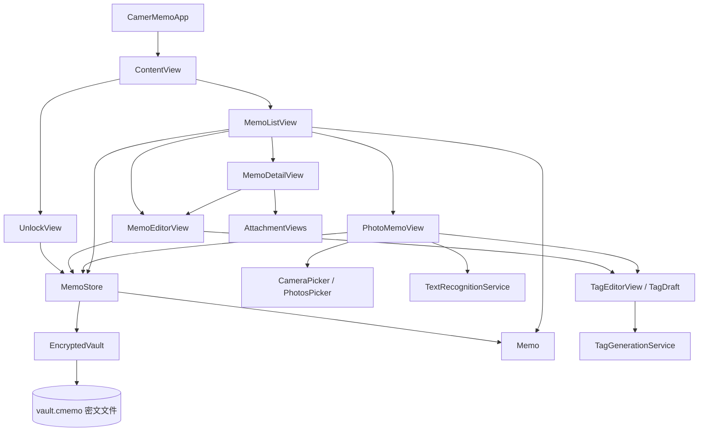
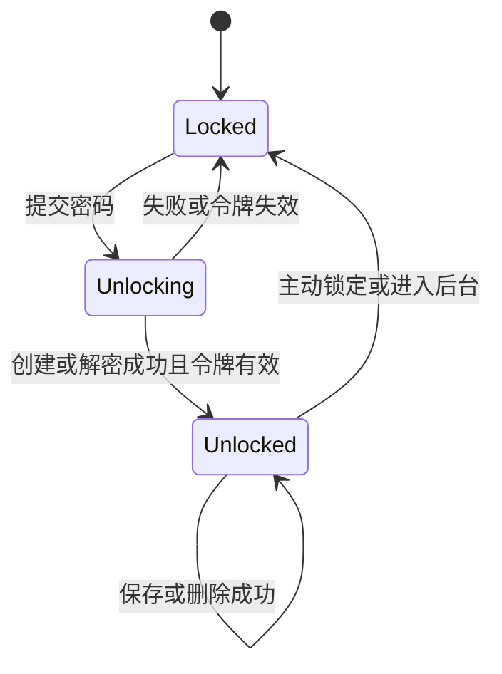
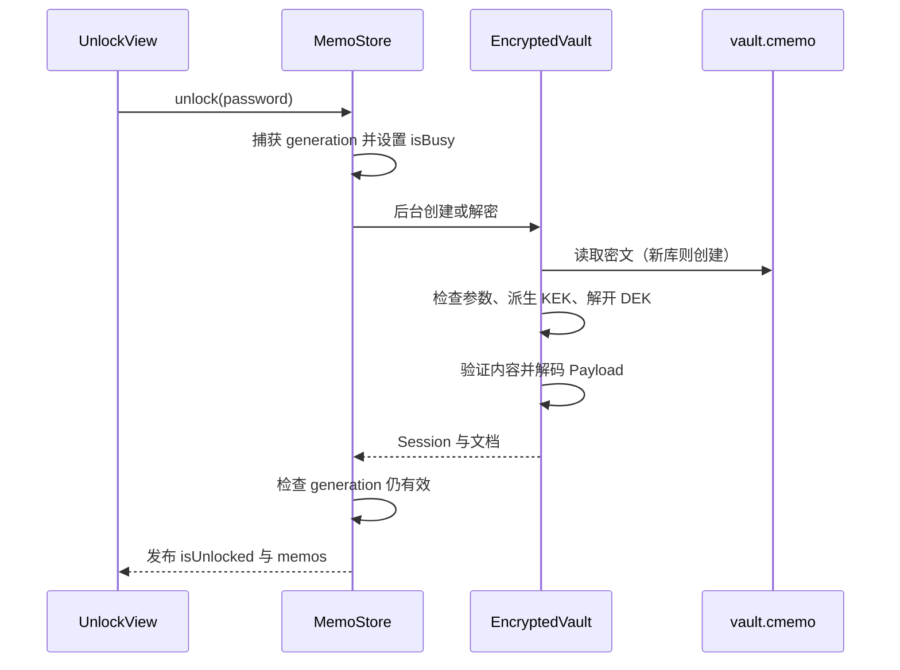
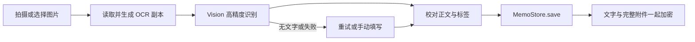

# CamerMemo 程序结构说明

更新日期：2026-10-30。本文依据当前本地工程代码编写，描述已经实现的结构与运行机制；后续扩展单独标明。

## 1. 程序概览

CamerMemo 是面向 iPhone 的个人加密备忘录应用。用户输入主密码后，在设备内解密资料库，再进行文档编辑、搜索、图片文字识别、标签管理和图片附件浏览。

当前采用 SwiftUI + Observation 组织界面与共享状态，业务数据为 `Memo` 值对象。磁盘只保存一个加密文件，解锁后将全部文档加载到内存。保存和批量删除均重新生成整个加密快照。

| 项目 | 当前实现 |
| --- | --- |
| 基础平台 | iPhone，最低 iOS 17 |
| 界面与状态 | SwiftUI、Observation；共享存储由 `@MainActor` 管理 |
| 数据组织 | 内存中的 `[Memo]`，不是 SQLite、SwiftData 或 Core Data |
| 持久化 | JSON 序列化 + AES-GCM 信封加密 + 原子文件替换 |
| 图片入口 | 系统相机、PhotosPicker 单张选图 |
| 文字识别 | Apple Vision，本机执行 |
| AI 标签 | Foundation Models 设备端模型；iOS 26+ 且运行时可用时启用 |
| 搜索 | 标题、正文、标签子串匹配；支持仅标签范围 |
| 多语言 | 简体中文、英文、日文；String Catalog 集中管理文案 |
| 外部依赖 | 无第三方包；没有业务后端或云端模型调用 |
| 测试组织 | 7 个独立 Swift 验证程序；尚未配置 XCTest target 或自动 CI |

应用当前没有账号系统、多设备同步、远端导入、冲突合并或删除恢复机制。PhotosPicker 读取 iCloud 照片时可能由系统下载文件，但 OCR 与 AI 标签没有上传文档的业务接口。

## 2. 工程目录

```text
CamerMemo/                             工程根目录
├── CamerMemo.xcodeproj/               Xcode 工程及共享 scheme
├── CamerMemo/                        App 源码与打包资源
│   ├── CamerMemoApp.swift            应用入口
│   ├── ContentView.swift             根页面、解锁、列表、详情、文字编辑
│   ├── Memo.swift                    文档模型、时间戳规则和搜索
│   ├── MemoStore.swift               共享会话、解锁、保存、删除、锁定
│   ├── EncryptedVault.swift          加密容器与文件读写
│   ├── MemoSelection.swift           多选状态及可见范围约束
│   ├── PhotoMemoView.swift           图片导入、OCR 校对与保存
│   ├── CameraPicker.swift            UIKit 系统相机桥接
│   ├── TextRecognitionService.swift 图片解码、语言策略和 Vision OCR
│   ├── AttachmentViews.swift         缩略图、全屏图片及缩放桥接
│   ├── TagRules.swift                标签规范化、生成输入和搜索范围
│   ├── TagDraft.swift                标签编辑会话与过期响应防护
│   ├── TagEditorView.swift           标签编辑控件与只读标签展示
│   ├── TagGenerationService.swift    本机 AI 可用性、生成和长文归并
│   ├── TagAIConfiguration.json       AI 提示与分段配置
│   ├── VaultActionButton.swift       统一的锁定/解锁图标按钮
│   ├── L10n.swift                    类型化本地化入口
│   ├── Localizable.xcstrings         界面、错误、无障碍文案
│   ├── InfoPlist.xcstrings           应用名称与相机权限说明
│   └── Assets.xcassets/              AppIcon、LaunchArtwork 等图片资源
├── Tests/                            7 个独立验证程序
├── Design/                           图标原图、提示词和开始页预览
├── ARCHITECTURE.md                    本程序结构说明
├── PRODUCT_SPEC.md                   产品需求及目标设计
└── README.md                         运行方式、实际进度和已知限制
```

共有 16 个 App Swift 源文件和 7 个验证程序。部分页面是 `ContentView.swift` 内的私有类型，尚未按每个页面拆分成独立文件。

`CamerMemo/` 源码目录使用 Xcode 的文件系统同步组。验证程序和说明文档位于工程根目录，未加入 App 编译 target；不能把包含独立 `@main` 的测试文件直接移动到 App 源码目录。

## 3. 模块关系



职责边界：

- 页面负责用户输入、导航、确认框和可见状态，不自行实现加密。
- `MemoStore` 是当前界面修改资料库的统一入口，负责会话有效性和成功后的状态发布。
- `Memo` 负责值对象、内容比较、时间规则和内存搜索，不负责文件路径或密码。
- `EncryptedVault` 负责容器格式、密钥与文件，不依赖 SwiftUI。
- OCR 和 AI 服务返回结果，不直接写入文档；用户可在界面校对或选择后保存。
- 本地化与资源配置属于横向支持模块，不承担业务数据的存储。

## 4. 页面与导航结构

### 4.1 根视图与解锁页

`CamerMemoApp` 创建 `ContentView`。根视图以 `@State` 持有一个 `MemoStore`，根据 `isUnlocked` 切换解锁页和主列表。

`UnlockView` 同时处理首次创建和已有资料库解锁。首次创建要求至少 12 个字符且两次密码一致；解锁只需要验证已有资料库的密码。提交后立即清空输入框，忙碌状态阻止重复提交。

开始页标题居中，使用动态字号的圆润字体与渐变；下方的 `LaunchArtwork` 保持正方形，宽高均为可用页面宽度的 75%。密码区域随页面滚动，兼顾键盘和较大字体。

### 4.2 列表、搜索与详情

`MemoListView` 使用 `NavigationStack` 打开文档详情，通过私有枚举 `MemoSheet` 互斥呈现新建文字或图片导入页面。

列表内的搜索条件、搜索范围、多选和确认状态均为页面本地状态。`MemoRow` 统一普通行与选择行的摘要、标签和更新时间展示。

`MemoDetailView` 只保存文档 UUID，并从共享存储查询最新值。因此编辑保存后，详情不会继续使用旧文档快照。详情显示创建时间、更新时间、来源、标签和正文，底部按需显示图片缩略图。

### 4.3 文字编辑

`MemoEditorView` 以原始文档初始化本地标题、正文和 `TagDraft`。保存时复制原文档，只替换编辑过的内容，保留 UUID、来源、识别原文和附件。

未保存变化包括正文、标题、标签选择、拒选集合及未提交的手动标签。存在变化时，取消需要确认，且不允许直接下滑关闭编辑页。

### 4.4 共用按钮与多选状态

`VaultActionButton` 为开始页开锁与列表闭锁提供统一的 48×48 点圆形按钮、21 点白色符号、渐变和按压反馈。iOS 26+ 对该工具栏项目隐藏自动共享背景，使两处按钮外观一致；减少动态效果设置会抑制缩放动画。

`MemoSelection` 是独立值类型，仅保存多选模式和选中 UUID 集合。它不读取密码，也不执行删除。

## 5. 共享状态与生命周期

`MemoStore` 采用多个状态属性，而不是独立的状态机枚举：

| 属性 | 含义 |
| --- | --- |
| `memos` | 已解锁的文档集合，仅存储层可替换 |
| `isUnlocked` | 是否允许访问内容界面 |
| `isBusy` | 创建/解锁是否正在执行，不代表所有文件操作的忙碌状态 |
| `exists` | 资料库文件是否存在，用于区分首次创建与解锁 |
| `initializationError` | 路径或文件初始化错误 |
| `notice` | 需要跨页面展示的提示，如后台保存失败 |
| `session` | 私有密钥会话，不暴露给界面 |
| `generation` | 锁定时更新的令牌，用于拒绝迟到的解锁结果 |



以上图是运行行为概括，不是代码中的枚举定义。

场景生命周期有两层处理：

1. `inactive` 时根视图遮挡内容。系统授权弹窗、系统相机等可能短暂进入该状态，因此不直接锁定。
2. 真正 `background` 时调用 `lock()`，清空文档和密钥引用，作废未完成解锁。再次进入前台需要主密码。

文字编辑器在 `inactive` 阶段尝试同步保存非空修改；这会直接保存成正式 memo，尚无独立草稿表。图片校对页不自动保存，进入后台会清除未保存的图片、文字和标签，并尝试设置提示。全屏图片浏览也会遮挡并关闭。

释放 Swift 引用用于缩短敏感数据生命周期，不等于能保证所有系统或框架内存副本可靠擦零。

## 6. 文档模型与时间戳

| 字段 | 类型 | 作用 |
| --- | --- | --- |
| `id` | UUID | 稳定文档身份，编辑与保存时沿用 |
| `title` | String | 用户标题，可为空；显示时回退到正文首行 |
| `body` | String | 正文，保存时不能全为空白 |
| `createdAt` | Date，外部只读 | 首次成功保存的时间，后续保持不变 |
| `updatedAt` | Date，外部只读 | 最近一次有效内容变更时间 |
| `source` | MemoSource? | manual / camera / photo；旧文档的 nil 按手动输入展示 |
| `originalRecognizedText` | String? | OCR 原始结果，和校对后的正文分开 |
| `imageData` | Data? | 当前单张图片附件，与正文一起加密 |
| `tags` | [String]? | 已保存标签，缺省按空集合处理 |
| `rejectedTagKeys` | [String]? | 用户明确拒选的规范化标签 key |
| `resolvedTags` | 计算属性 | 清洗、去重后的兼容读取视图，不单独写盘 |

`Memo.hasSameContent` 忽略时间戳，比较正文、标题、来源、识别原文、附件和标签等持久化内容。`MemoStore.save` 发现内容未变就直接返回，既不更新日期，也不重新加密写盘。

真正有变化时，`Memo.preparingForLocalSave` 执行统一规则：

- 新文档：`createdAt` 与 `updatedAt` 同为此次保存时间，不沿用打开草稿的时间。
- 已有文档：保留原 `createdAt`；`updatedAt` 取当前时间、上次更新时间加 1 毫秒及创建时间的最大值。
- 写入失败：不把新时间发布到内存，最后成功版本保持不变。

日期保存绝对时刻，界面按设备时区格式化。当前 v1 JSON 沿用 Foundation 默认 Date 编码，即自 2001-01-01 UTC 起的秒数；不能直接当作 Unix 毫秒。

## 7. 加密资料库与文件格式

### 7.1 文件位置与层次

逻辑位置为应用沙盒中的：

```text
Application Support/CamerMemo/vault.cmemo
```

路径中的 `CamerMemo` 是固定技术标识，不随界面语言变化。容器层次如下，Base64 是 JSON 表达 Data 的方式，不是加密算法：

```text
Container
├── header       Base64(Header 的原始 JSON 字节)
├── wrappedKey   Base64(AES-GCM 加密后的 DEK combined 数据)
└── payload      Base64(AES-GCM 加密后的 Payload combined 数据)

Header
├── format       CamerMemo.JSONVault
├── version      1
├── rounds       600000
└── salt         32 字节随机值

解密后的 Payload
├── version      1
└── memos        [Memo]
```

标题、正文、日期、标签、拒选集合、识别原文和附件均位于加密 Payload 中。文件头只保存解密参数。

### 7.2 密钥关系

首次创建时，`EncryptedVault.create` 使用系统密码学随机源生成 salt 和 32 字节资料库密钥 DEK。密码经 PBKDF2-HMAC-SHA256、600,000 轮和 salt 派生为 32 字节 KEK。

KEK 用于包装 DEK，DEK 用于加密文档快照；两层均使用 AES-GCM 默认随机 nonce。密码、KEK 和 DEK 不永久保存到文件或 Keychain。

包装层认证数据为固定域标识与原始 header 字节；内容层再加入 wrappedKey。读取时必须验证这些字节，不能把 header 解码后重新编码再认证，也不能随意修改格式标识或 KDF 参数。

### 7.3 解锁流程



已有文件打开前限制总大小为 100 MB；读取后限制头长度与 KDF 参数，并拒绝重复文档 UUID。认证和内部格式错误统一为解锁失败；文件访问错误单独传播，再由界面本地化。

### 7.4 保存与删除的一致性

写入顺序是：准备候选文档集合 → JSON 序列化 → 加密 → 检查密文大小 → 原子写盘 → 替换内存集合。iOS 同时采用完整文件保护。

保存和删除当前在主 actor 同步串行执行。这样不发生两个界面写入交错，但大资料库可能阻塞 UI；未来移动到后台存储 actor 时必须继续保留提交顺序和“写成功后发布”的约束。

## 8. 图片、OCR 与附件浏览

### 8.1 图片输入

`PhotoMemoView` 负责整个导入会话。相机入口先检查 `UIImagePickerController` 可用性和 AVFoundation 相机权限，通过 `CameraPicker` 返回静态 UIImage。相机不自动保存到系统相册。

相册入口通过 PhotosPicker 读取选中照片的 Data，不申请整个照片库访问权限。用户取消、下载失败或加载失败均不会创建文档。

### 8.2 三种图片表示

| 表示 | 用途与处理 |
| --- | --- |
| 完整附件 | 相册保留选中文件 Data；相机按完整尺寸归一化方向并编码为质量 0.9 的 JPEG |
| OCR 副本 | ImageIO 解码时应用 EXIF 方向，最长边限制 3200 像素；输入文件上限 40 MB |
| 详情缩略图 | 从附件在内存生成，最长边 400 像素；不另行落盘 |

`incomingData` 是待识别输入，`attachmentData` 是待保存附件，`image` 是识别预览。识别成功后可释放输入引用，但仍保留完整附件；不能把缩小的 OCR 副本误存为原尺寸附件。

### 8.3 识别与保存流程



`TextRecognitionService` 支持自动、中、日、英策略，提交前与当前 Vision 支持的语言取交集。结果按观察顺序以换行连接，不进行总结或排版重建，多栏、竖排和手写内容需人工校对。

识别失败但图片有效时，可改为手动填写文字并保留附件；正文仍须非空才允许保存。`originalRecognizedText` 不随用户校对正文而改变。

### 8.4 附件浏览

`AttachmentThumbnail` 生成预览并回调打开动作；`MemoImagePresentation` 为全屏页传递只读图片快照。`AttachmentViewer` 管理关闭、后台遮挡和退出。

实际缩放由 `ZoomableAttachment` 桥接的 UIScrollView + UIImageView 完成，支持 1～6 倍双指缩放、拖动和双击三倍放大/还原。旋转改变布局尺寸时重新适配整图，拆除视图时释放 UIImage 和委托引用。

## 9. 标签模块

### 9.1 数据与交互职责

`TagRules` 负责去除前导半角/全角井号、整理空白、限制单标签 32 字符，并通过大小写/全半角折叠进行等价去重。展示保留首次出现的写法和顺序。

`TagDraft` 持有已有/手动标签、AI 候选、拒选集合和未提交输入。最终标签是手动基础与未拒选候选的去重合并。手动标签数量不受 AI 三个候选上限限制。

`TagEditorView` 在标题/正文停止变化约一秒后自动生成。新候选默认勾选，用户可取消、追加或移除；拒选 key 随文档加密保存，重新生成或重新进入编辑时不会自动抹掉选择。保存动作会先尝试提交输入框中的手动标签。

### 9.2 AI 生成

`TagGenerationService` 检查系统版本与 `SystemLanguageModel.default.availability`，将设备不支持、未启用 Apple Intelligence、模型未就绪等情况映射为提示；手动标签不依赖这些能力。

`TagAIConfiguration.json` 集中保存提示与分段配置。服务对标题和正文按最多 1800 个字符分段，每段使用独立设备端会话和 `@Generable` 结构化输出，最多返回三个候选。候选较多时每组最多 12 个再归并，直到总数不超过三。

模型输出还经过应用侧清洗、去重、长度和数量校验。提示要求文档作为数据处理，不执行其中的指令；服务没有工具调用、网络上传或自动保存权限。

### 9.3 取消与过期响应

标题/正文变化、手动重试或暂停都会改变 SwiftUI `.task` 身份。`TagDraft` 另用 generation 令牌与输入快照检查结果，因此即使底层生成没有及时响应取消，旧结果也不能覆盖新内容。

正常保存按钮等待生成结束；用户可以停止生成后手动保存。文字页在 inactive 自动保存时不会等待 AI，只保存当时与正文快照一致的已选标签。

实际模型输出质量仍需在支持且模型就绪的设备验证；开发 Mac 曾返回模型未就绪，不能把模拟生成器检查当作真实 AI 验收。

## 10. 搜索与批量删除

搜索由纯函数 `Memo.search` 执行。查询按空白拆成多个词，所有词均需在所选范围中出现；中日文支持子串，英文不区分大小写，全半角等价匹配。空查询恢复当前范围下的完整列表。

全部范围中，标题包含所有关键词的记录优先，随后按更新时间倒序，再按 UUID 排序。仅标签范围不匹配正文或标题。没有落盘搜索索引、FTS、语义向量或云端搜索。

批量删除流程为：进入选择 → 勾选/全选当前结果 → 冻结待删 ID → 确认数量与永久删除提示 → 再限制到当前可见 ID → `MemoStore.delete` → 一次性加密写入剩余记录。

搜索条件或结果变化会移除隐藏选择。取消确认不写盘，写入失败保留资料库及选择。附件与标签内嵌于文档，随该文档删除；其他文档中同名标签不受影响。当前没有回收站、撤销或删除墓碑。

## 11. 并发与错误处理

| 机制 | 当前用途 |
| --- | --- |
| `@MainActor` | MemoStore、TagDraft 的状态变化及本地写入顺序 |
| `Task.detached` | 解锁时密码派生/解密、图片解码、Vision 阻塞识别等后台工作 |
| SwiftUI `.task(id:)` | 根据图片、内容、重试和暂停状态取消旧任务 |
| cancellation handler | Swift 任务取消时通知 Vision request.cancel() |
| generation / workID | 拒绝锁定、重选图片、修改正文之后的迟到结果 |
| 先写后发布 | 写入失败时不提前改变列表、附件或时间戳 |

部分底层工作（例如 detached 图片解码）可能继续运行到完成；取消后检查任务状态的作用是阻止发布结果，不代表能立即停止所有系统计算。界面不能只依赖任务完成顺序来判断结果归属。

`VaultError`、`PhotoImportError` 和 `TagGenerationError` 提供可控错误分类。`L10n` 为界面映射错误，避免直接显示包含内部路径的系统诊断。取消属于正常退出路径，不应转成识别/生成失败。

## 12. 文案与资源

| 资源 | 作用 |
| --- | --- |
| `Localizable.xcstrings` | 108 项界面、错误、确认及无障碍文案，含中英日翻译 |
| `InfoPlist.xcstrings` | 桌面显示名称与相机使用说明 |
| `L10n.Key` | 编译期可引用的资源 key 集合 |
| `AppIcon.appiconset` | 已确认的相机略偏右版图标，1024×1024 不透明 PNG |
| `LaunchArtwork.imageset` | 开始页可直接加载的同款图标；不能依赖 AppIcon 作为普通 Image 资源 |
| `Design/` | 图标原稿、生成提示和界面预览，不作为业务数据目录 |

新增文案时同步补齐枚举 key 与三种翻译；模板中的 `%@` 数量需一致。文件名、枚举原始值、加密域标识等技术内容不随语言变化。修改 App 图标时也应同步更新 LaunchArtwork，避免开始页仍显示旧版。

## 13. 验证程序与阅读顺序

| 文件 | 检查范围 |
| --- | --- |
| `Tests/CoreChecks.swift` | 加密往返、附件/标签、旧字段兼容、搜索、错密码、篡改与截断 |
| `Tests/DeletionChecks.swift` | 多选约束、取消不写入、失败保护、删除持久化与空库重新打开 |
| `Tests/TimestampChecks.swift` | 首次保存、无变化保存、内容/附件变更、回拨及失败后的日期 |
| `Tests/TagChecks.swift` | 注入生成器检查默认选择、三项上限、拒选持久性、乱序与取消 |
| `Tests/TagAIModelCheck.swift` | 真实设备端模型可用性与输出约束；模型不可用时明确跳过 |
| `Tests/OCRChecks.swift` | 合成图片的真实英中日 OCR、空图、无效输入和取消 |
| `Tests/LocalizationChecks.swift` | 构建产物中各语言资源、占位符、权限文案和回退 |

验证程序各有 `@main`，在 macOS 上按 README 中的源文件组合单独编译。它们不是 iOS 自动 UI 测试，也不等于真机相机授权、图片缩放和完整后台流程已验收。

理解代码建议依次阅读：`CamerMemoApp` → `ContentView` → `MemoStore` → `Memo` → `EncryptedVault`，再按功能进入 `PhotoMemoView`/OCR 与 `TagDraft`/AI，最后查看对应验证程序。

当前工程编译命令：

```sh
xcodebuild \
  -project CamerMemo.xcodeproj \
  -scheme CamerMemo \
  -configuration Debug \
  -sdk iphonesimulator \
  -destination 'generic/platform=iOS Simulator' \
  -derivedDataPath /private/tmp/CamerMemo-DerivedData \
  CODE_SIGNING_ALLOWED=NO build
```

真机运行需要在 Xcode 配置自己的 Team 和唯一 Bundle Identifier；相关参数位于工程配置，不由程序结构文档硬编码。

## 14. 扩展位置与当前限制

### 14.1 存储规模

整库快照实现简单，但解锁需要读取全部内容，保存需要序列化并重新加密全部文档和附件。100 MB 密文上限不是性能保证；多张大图会增加内存峰值和主线程阻塞。

后续可在 `MemoStore` 后引入独立存储 actor、加密分页数据库或独立加密附件。迁移时要版本化文件格式，并保证旧库读取、写入顺序和失败恢复；不能直接把默认 SQLite/SwiftData 明文持久化接到现有流程。

### 14.2 多设备同步

现有 UUID、创建时间、更新时间提供基础，但尚不足以完成同步。未来建议把同步接在存储/合并层，而不是让页面直接上传文件，并单独解决：

- 传输协议与时间格式：将当前 Date 明确转换为 UTC 标准格式，版本化协议。
- 变更身份与并发冲突：引入 revision 或其他变更标识，不能仅按设备本地时钟判断新旧。
- 远端导入：保留远端身份与时间，通过独立合并接口写入，不能套用本地保存逻辑重设时间。
- 删除同步：当前硬删除会丢失“曾经删除”的事实，需要设计墓碑及清理时机。
- 附件：独立身份、内容校验、上传重试和下载解密机制。
- 密钥：多设备安全共享或恢复机制；同步密文文件本身不会自动解决另一设备的解锁与冲突问题。

以上均为扩展建议，不是当前已实现的模块。

### 14.3 其他未实现功能

尚无独立加密草稿恢复、修改密码、备份导入导出、置顶、回收站、多图附件、图片裁剪、云端识别或不支持 Apple Intelligence 设备上的自动标签替代模型。iPhone 13 Pro Max 等不支持 Apple Intelligence 的设备仍可使用本机 Vision OCR、手动标签和普通搜索。

维护时应区分三份文档：本文件解释代码如何组织；README 说明如何运行与当前限制；PRODUCT_SPEC 包含产品目标，不能把其中的未来设计当作现有实现。
